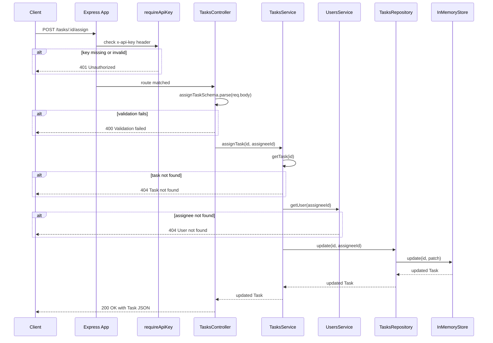

# Architecture Overview

TaskFlow follows a strict four-layer architecture per module: **routes → controller → service → repository → store**. Dependencies always flow inward — controllers depend on services, services depend on repositories, repositories depend on the store. No layer above the repository touches storage directly.

## Application assembly

`src/app.ts` exports a `createApp(): Express` factory that wires up:

1. `express.json()` — global body parser (JSON only).
2. `GET /health` — unauthenticated health check returning `{ status: "ok" }`.
3. `/users` and `/tasks` route groups, both gated by the `requireApiKey` [middleware](/openwiki/middleware/middleware.md).
4. `notFoundHandler` — catches all unmatched routes (404).
5. `errorHandler` — central error handler, registered last (4-arg Express error middleware).

`src/server.ts` is the entry point — it calls `createApp()` and starts listening on `env.PORT`.

## Module layering

Each module (`users`, `tasks`) follows the same internal structure:

| Layer | File pattern | Responsibility |
|---|---|---|
| Routes | `*.routes.ts` | Maps HTTP method + path to controller handler |
| Controller | `*.controller.ts` | Zod `.parse()` on body/query, calls service, shapes HTTP response |
| Service | `*.service.ts` | Business logic, invariants, throws `AppError` for domain failures |
| Repository | `*.repository.ts` | CRUD via `InMemoryStore`, sets timestamps and IDs |
| Schemas | `*.schemas.ts` | Zod validation schemas for request input |

Controllers hold no business logic. Services hold no HTTP concerns. Repositories are the only layer that imports `InMemoryStore`.

### Cross-module coupling

`tasks.service.ts` imports `usersService` directly to validate that an assignee exists before assigning a task. This is the only place the two modules are coupled — it's a service-to-service dependency, not a shared repository or shared store.

## Request lifecycle: POST /tasks/:id/assign

This is the most interesting request path because it exercises the cross-module dependency. The flow:

*Sequence diagram of `POST /tasks/:id/assign` — the one request that crosses module boundaries via the `tasksService → usersService` dependency.*

## InMemoryStore — the persistence seam

`src/db/in-memory-store.ts` exports `InMemoryStore<T extends { id: string }>`, a generic collection backed by `Map<string, T>`. Each repository instantiates its own store instance.

| Method | Behavior |
|---|---|
| `create(build)` | Generates a `randomUUID`, calls `build(id)` to construct the record, stores and returns it |
| `findAll()` | Returns all records as an array |
| `findById(id)` | Map lookup by key |
| `update(id, patch)` | Shallow-merges patch into existing record; returns `undefined` if not found |
| `delete(id)` | Deletes from map; returns true if existed |

The `create` method uses a **builder callback pattern** — the caller constructs the full record using the generated ID, so the store controls ID creation. This prevents callers from setting their own IDs.

All data is lost on process restart — there is no persistence beyond the in-memory `Map`. Replacing this with a real database only requires changing the repository implementations; services and controllers are unaffected.

## Configuration

`src/config/env.ts` uses Zod to validate environment variables at startup. The schema:

| Variable | Type | Default | Validation |
|---|---|---|---|
| `PORT` | number | `3000` | `int().positive()` |
| `API_KEY` | string | `"dev-local-key"` | `min(1)` |

Parsing happens at module load time, so invalid env vars cause immediate startup failure (fail-fast).
