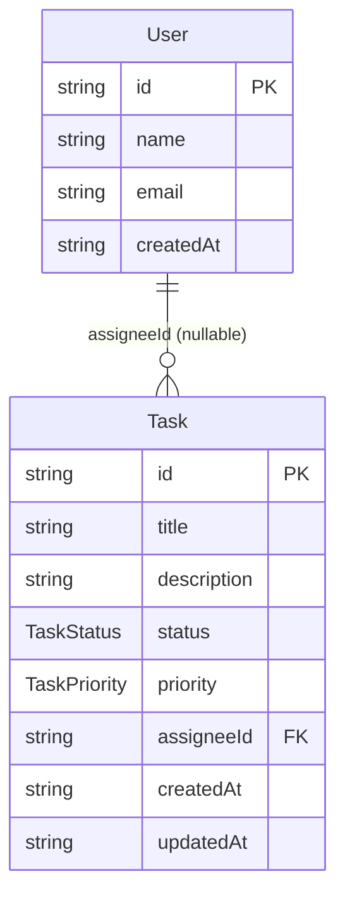

# Domain Model and Invariants

The canonical domain types live in `src/types/index.ts`. Validation schemas live in each module's `*.schemas.ts` file. Business invariants are enforced in the service layer — **not** in the schemas.

## Entity relationship

*ER diagram of the User and Task entities. `Task.assigneeId` is a nullable foreign key to `User.id` — a task may be unassigned.*

## Types

| Type | Definition |
|---|---|
| `TaskStatus` | `"todo" \| "in_progress" \| "done"` |
| `TaskPriority` | `"low" \| "medium" \| "high"` |
| `User` | `{ id: string; name: string; email: string; createdAt: string }` |
| `Task` | `{ id: string; title: string; description: string; status: TaskStatus; priority: TaskPriority; assigneeId: string \| null; createdAt: string; updatedAt: string }` |

Key design notes:

- `assigneeId` is `string | null` — a task may be unassigned.
- All timestamps are ISO strings (not `Date` objects).
- IDs are UUIDs generated by `InMemoryStore.create()` — callers never set IDs.
- `description` defaults to `""` if omitted at task creation.

## Validation schemas

Schemas are the **input boundary** — they validate shape and types, not business rules.

### Users (`src/modules/users/users.schemas.ts`)

| Schema | Fields | Rules |
|---|---|---|
| `createUserSchema` | `name` | `z.string().min(1)` — "name is required" |
| | `email` | `z.string().email()` — "email must be a valid email address" |

### Tasks (`src/modules/tasks/tasks.schemas.ts`)

| Schema | Fields | Defaults | Notes |
|---|---|---|---|
| `createTaskSchema` | `title: string().min(1)` | — | Only strictly required field |
| | `description: string()` | `""` | |
| | `priority: enum(low, medium, high)` | `"medium"` | |
| `updateTaskStatusSchema` | `status: enum(todo, in_progress, done)` | — | No transition restrictions |
| `assignTaskSchema` | `assigneeId: string().min(1)` | — | Non-empty string |
| `listTasksQuerySchema` | `status?: enum(...)` | — | Optional filter |
| | `assigneeId?: string()` | — | Optional filter |

## Service-layer invariants

These rules are enforced in `*.service.ts` and cannot be caught by schema validation alone. Services throw `AppError(statusCode, message)` for violations, which the [error middleware](/openwiki/middleware/middleware.md) maps to HTTP responses.

### Unique user emails

`usersService.createUser` (`src/modules/users/users.service.ts`) calls `usersRepository.findByEmail(email)` before creating. If a user with that email already exists, it throws `AppError(409)`.

### Assignee must exist

`tasksService.assignTask` (`src/modules/tasks/tasks.service.ts`) validates in two steps:
1. `this.getTask(id)` — throws `AppError(404, "Task not found: <id>")` if the task doesn't exist.
2. `usersService.getUser(assigneeId)` — throws `AppError(404, "User not found: <id>")` if the assignee doesn't exist.

This is the [architecture](/openwiki/architecture/overview.md) cross-module dependency: `tasks.service` imports `users.service` directly.

### No status transition restrictions

Despite having a `TaskStatus` enum (`todo → in_progress → done`), the service layer imposes **no state machine**. Any status can be set to any other status at any time via `PATCH /tasks/:id/status`. This is intentional simplicity for a sample project.

## Repository-layer defaults

The repository layer enforces a few defaults that callers cannot override:

- **New tasks** always start with `status: "todo"` and `assigneeId: null` — these are not caller-controllable at creation time (`src/modules/tasks/tasks.repository.ts`).
- `createdAt` is set on creation; `updatedAt` is automatically refreshed on every update call, regardless of which fields changed.
- `id` and `createdAt` on `User` are set by the repository, not by callers.
