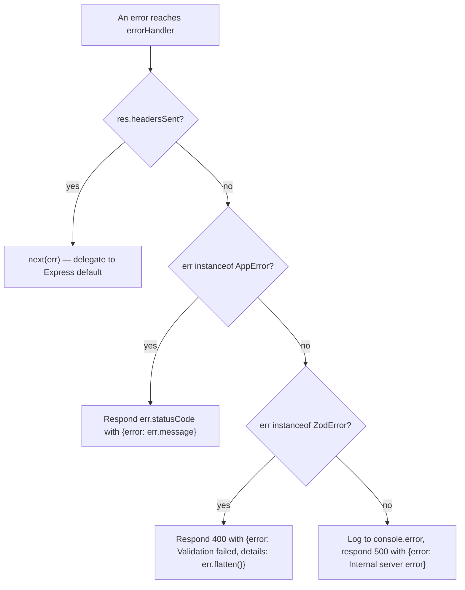

# Auth and Error Middleware

Two middleware pieces in `src/middleware/` are cross-cutting concerns that are easy for new contributors to miss. Both are wired into the Express app in `src/app.ts`.

## Auth middleware

**File:** `src/middleware/auth.middleware.ts`

`requireApiKey` is an Express middleware that gates all `/users` and `/tasks` routes. It is applied at the router mount level in `src/app.ts`:

```typescript
app.use("/users", requireApiKey, usersRouter);
app.use("/tasks", requireApiKey, tasksRouter);
```

Only `GET /health` is publicly accessible.

**How it works:**

1. Reads the `x-api-key` request header.
2. Compares against `env.API_KEY` (from `src/config/env.ts`, defaults to `"dev-local-key"`).
3. On mismatch: responds `401` with `{ error: "Unauthorized: missing or invalid x-api-key header" }` and returns — does **not** call `next()`.
4. On match: calls `next()` to continue the request chain.

**Important:** The comparison uses plain `!==`, not a constant-time comparison. This is acceptable for a sample project but would be a timing-attack concern in production.

There is no per-user auth or session concept — the API key is a single shared static secret. The `User` records in the [domain model](/openwiki/domain/model.md) have no password or credential fields.

## Error middleware

**File:** `src/middleware/error.middleware.ts`

This file exports three things:

### `AppError` — custom error class

A subclass of `Error` with an added `statusCode` property. Services throw `AppError(statusCode, message)` for expected domain failures (e.g., 404 for "User not found", 409 for duplicate email).

| Property | Type | Description |
|---|---|---|
| `statusCode` | `number` | HTTP status code to return |
| `message` | `string` | Error message (inherited from `Error`) |
| `name` | `string` | Always `"AppError"` |

### `notFoundHandler` — 404 handler

Catches all unmatched routes. Responds `404` with `{ error: "Route not found: <METHOD> <path>" }`.

### `errorHandler` — central error middleware

Express error middleware (4-arg signature), registered last in the pipeline. It handles errors thrown anywhere in the request [lifecycle](/openwiki/architecture/overview.md):



*Error handling decision flow in `errorHandler`. `AppError` comes from services; `ZodError` comes from controller `.parse()` calls; anything else is a 500.*

## Error flow through the architecture

The two error types originate at different layers and are caught centrally:

- **`ZodError`** — thrown by `.parse()` calls in controllers (`*.controller.ts`) when request input fails validation. Mapped to `400` with structured validation details.
- **`AppError`** — thrown by services (`*.service.ts`) when [domain invariants](/openwiki/domain/model.md) are violated. Mapped to the service-specified status code (typically 404 or 409).
- **Unknown errors** — logged to `console.error` and mapped to `500` with a generic message.

This means controllers and services never need to catch their own errors — they simply throw, and the error middleware shapes the HTTP response. The one exception is the `headersSent` guard: if headers were already sent (e.g., a streaming response), the middleware delegates to Express's built-in error handler via `next(err)`.
